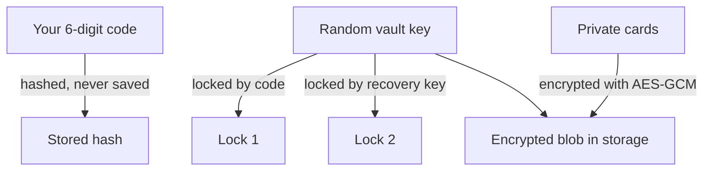
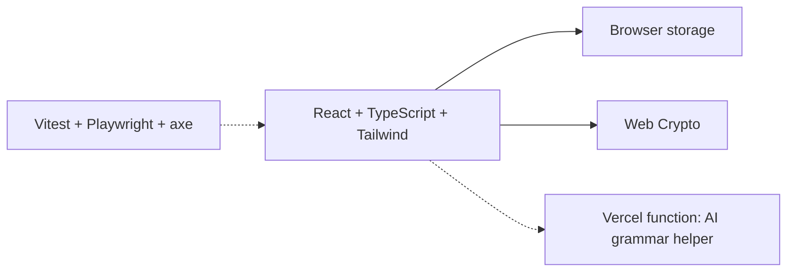

# ShowCard

ShowCard is a card app for Deaf and Hard of Hearing people.

You write a message once and save it as a card. When you need it, tap the card. The screen shows the message in big text. The other person reads it. No typing back and forth, no talking.

I designed, built, and tested it by myself.

## See it in 3 steps

```mermaid
flowchart LR
  A ["Pick a card"] --> B ["Tap it"] --> C ["Show the screen"]
```

## What you can do

| Feature | What it means |
| --- | --- |
| Cards | Make, edit, delete, and sort your messages |
| Full screen | Big text. Flip it around for a person across a table |
| Categories | Medical, Services, Daily, Vault, or your own. Tap All to see everything. |
| Emergency | A red button in the header. One tap shows the emergency cards. |
| Undo | After you delete a card, an Undo button stays for 5 seconds. |
| Swipe | On a phone, swipe left to edit or delete |
| Write a note | Write a message and show it now, without saving it. Save it as a card only if you want to. The text box grows as you type. |
| Undo | After you delete a card, an Undo button stays for 5 seconds. |
| Vault | A locked area for private info, like an ID or address |
| Recovery key | A backup key to open the Vault if you forget the code |
| Settings | Text size and color mode change right away. Accent color and code changes save when you tap Save. |

## How the Vault stays private

The Vault has a six-digit code. Here is what happens behind it:



In plain words:

- The code is never saved. Only a hash of it is saved.
- Your private cards are scrambled and saved as one block.
- The key that unscrambles them is locked two ways. One lock uses your code. The other uses the recovery key.
- When you lock the Vault, the open cards and the key leave memory.
- Private cards can only be added while the Vault is open.
- Five wrong codes lock the keypad for one minute.
- If you use the recovery key, the Vault opens. Then you set a new code. The recovery key stays valid until you do.

A changed code only changes the lock, so the cards do not need to be scrambled again.

| Protection | How |
| --- | --- |
| Code storage | PBKDF2-SHA256, 310,000 rounds, random salt per code |
| Card storage | AES-GCM encryption, one encrypted block |
| Key storage | Random 256-bit key, locked by code and by recovery key |
| Recovery key | 16 characters, shown once, saved only as a SHA-256 hash |
| Wrong codes | Five tries, then a 60-second lock |
| Old data | Older plain-text code is hashed on load. Older plain-text Vault cards are encrypted the first time you unlock the Vault. |

**Limit:** a six-digit code is short. If someone copies the saved browser data, they can guess codes on their own computer. A longer code is my next change.

## Accessibility

- A font made for low vision readers (Atkinson Hyperlegible)
- Three color modes: Light, Dark, and High Contrast. Light mode uses a warm off-white to reduce glare.
- Automated checks find no contrast problems on the main and Settings screens (text and borders)
- Every button has a 36px or larger target, and every icon has a label
- Keyboard users get a clear focus ring, a "Skip to cards" link, and the Escape key closes dialogs
- The category row is a labeled navigation region
- Automatic checks (axe) on the main and Settings screens in all three modes

## Tests

| What | How many | Command |
| --- | --- | --- |
| Small tests (unit) | 62 | `npm test` |
| Browser tests | 42, phone and desktop sizes | `npx playwright test` |
| Type check | 1 | `npx tsc --noEmit -p .` |

## Tech I used



- **React 19 and TypeScript** for the screens
- **Vite 6** to build it
- **Tailwind CSS 4** for styling
- **Web Crypto** for the encryption, built into the browser
- **Vercel Edge function** for the AI helper, so the API key stays on the server
- **Vitest, Playwright, and axe** for testing

## Run it

You need Node.js 18 or newer.

```bash
npm install
npm run dev
```

Then open http://localhost:3000. If that port is busy, Vite picks another one and shows it in the terminal.

## What changed recently

**Latest (November 10, 2026)**

- Plainer wording throughout: Look, Text size, Code, Strong colors, Biggest, Private, Make private, Log out, Edit list, Edit Groups, Emergency.
- Write a note (pen icon) replaces Quick write. The text box grows as you type.
- Every icon is our own. The icon library was removed, which makes the app smaller.
- Clear key on the code keypad. The Delete key is a circle with an X, like the number keys.
- Lighthouse on the live site: 100 for performance on mobile and desktop.
- Secret Code is exactly 6 digits. It is checked as soon as the sixth digit is typed.
- Tapping the lock button locks the Vault and opens the code screen in one tap.
- The logout button is light gray when no code is set, and accent when a code is set.
- Card editor: Back button with a label, title on its own line with an icon, red lock button when the card is private.
- Edit list: smaller rows and arrows, bigger group names, a circle add button.
- Undo bar for five seconds after deleting a card.
- Removed the unused Gemini service file and its build settings.

- Renamed the app to ShowCard. New speech-bubble brand icon in the header and as the favicon.
- Write a note: write a message and show it now. Save it as a card only if you want.
- Emergency moved into the header. The category row is simpler: one size, round pills.
- Header and card buttons are smaller and evenly spaced.
- Light mode uses a warm off-white background with darker borders for contrast.
- Keyboard and screen reader support: focus rings, skip link, Escape to close, and labeled navigation.
- Settings is smaller, with more space. Theme modes have their own icons. Display sizes are plain text.
- The burger menu dims the page behind it.
- On phones, the logout icon is in the menu. Desktop shows it in the header.
- Tapping into a text box shows a yellow border.
- Five-second Undo after deleting a card.

**November 10, 2026**

- Vault cards are now encrypted as one block. Before, they were plain text in storage.
- The vault key is locked two ways (by the code and by the recovery key). Changing the code only changes the lock.
- The Secret Code is saved as a hash, not as plain text. Older plain-text codes are converted on load.
- Private cards need an unlocked Vault. Older plain-text Vault cards are moved into the encrypted Vault on first unlock.
- The recovery key is shown once when you set a code. There is a recovery form to use it.
- Added browser tests (Playwright) and accessibility checks (axe) in three color modes.

**November 9, 2026**

- Text size and color mode change right away in Settings.
- Accent color on the keypad and the swipe actions.
- Added the first test suite.

## Status

Built and tested in desktop and phone-sized browsers.

Not done yet:

- Not tested on real iPhone or Android phones with a screen reader
- The AI grammar helper is built, but no screen uses it yet
- No sync or backup. Clearing browser data deletes everything
- No home screen install or offline mode yet

## Author

Dwight Rogers. Designed, built, and tested solo.
