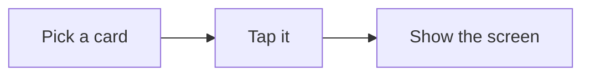
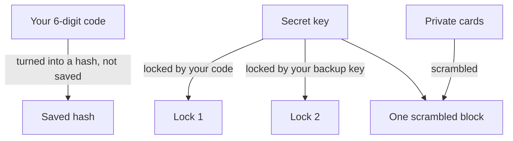
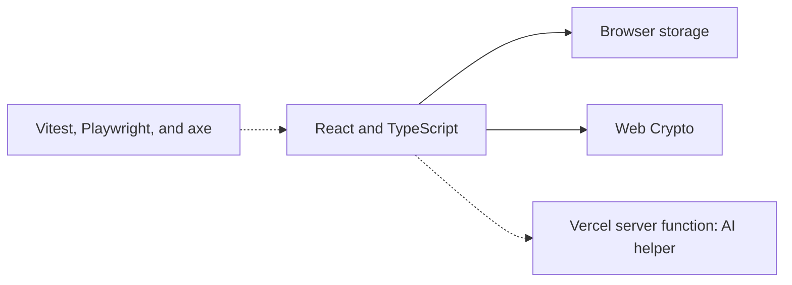

# ShowCard

ShowCard is an app for Deaf and hard of hearing people.

You write a message one time. You save it as a card. When you need it, you tap the card. The screen shows the words in big letters. The other person reads them. You do not have to type or talk.

I made this app by myself. I designed it, built it, and tested it.

## How it works



## What you can do

| Feature | What it does |
| --- | --- |
| Cards | Make, change, delete, and sort your messages |
| Big screen | Shows one card in big letters. You can flip it for a person across a table. |
| Groups | Medical, Services, Daily, Private, or your own. Tap All to see everything. |
| Emergency | A red button at the top. One tap shows the emergency cards. |
| Undo | After you delete a card, an Undo button stays for 5 seconds. |
| Swipe | On a phone, swipe left to change or delete a card. |
| Write a note | Write a message and show it right away. It is not saved unless you save it as a card. |
| Private | A locked place for private info, like an ID or address |
| Backup key | A key you can use to get into Private if you forget your code |
| Settings | Change the text size and colors. Text size and colors change right away. |

## How the private part stays safe

Private has a 6-digit code. Here is how it keeps your info safe:



What this means:

- Your code is never saved. Only a hash of it is saved.
- Your private cards are scrambled and saved as one block.
- The secret key that unscrambles them has two locks. Your code opens one lock. Your backup key opens the other.
- When you lock Private, the open cards and the key are removed from the screen.
- You can only add private cards when Private is open.
- Five wrong codes lock the keypad for one minute.
- If you use your backup key, Private opens. Then you make a new code. The backup key still works until you do.
- If your code is right but the private cards cannot be read, the app tells you. It does not say "wrong code," and it does not count it as a wrong try.

When you change your code, only the lock changes. The cards do not have to be scrambled again.

| Part | How it is kept safe |
| --- | --- |
| Code | Saved only as a hash, with 310,000 steps and a random salt |
| Cards | Scrambled with AES-GCM and saved as one block |
| Secret key | Random, and locked by your code and your backup key |
| Backup key | 16 letters and numbers, shown one time, saved only as a hash |
| Wrong codes | Five tries, then a 60-second wait |
| Old data | An old plain-text code is turned into a hash when the app opens. Old private cards are scrambled the first time you open Private. |

**Limit:** a 6-digit code is short. If someone copies the saved data from the browser, they could guess the code on their own computer. A longer code is the next thing I want to add.

## Accessibility

- The font was made for people who have trouble seeing small letters (Atkinson Hyperlegible)
- Three color modes: Light, Dark, and High Contrast. The light mode uses a soft off-white so it is not too bright.
- Automatic checks find no problems with color contrast on the main and Settings screens
- Buttons are big, and every icon has a name that a screen reader can say
- You can use the keyboard. There is a "Skip to cards" link, a clear focus ring, and the Escape key closes most pop-up windows.
- The category row is marked as a navigation area for screen readers

## Tests

| What | How many | Command |
| --- | --- | --- |
| Small tests (unit) | 62 | `npm test` |
| Browser tests (phone and desktop) | 76 | `npx playwright test` |
| Type check | 1 | `npx tsc --noEmit -p .` |

## Tools I used



- **React 19 and TypeScript** to build the screens
- **Vite 6** to build the app
- **Tailwind CSS 4** for styles
- **Web Crypto** for scrambling, which is built into the browser
- **A Vercel server function** for the AI helper, so the secret key stays on the server
- **Vitest, Playwright, and axe** for tests

## Run it on your computer

You need Node.js version 18 or newer.

```bash
npm install
npm run dev
```

Then open http://localhost:3000 in your browser. If that port is busy, the app uses another port and shows it in the terminal.

## What changed recently

**November 10, 2026**

- Private cards are now scrambled into one block. Before, they were plain text.
- The secret key has two locks: the code and the backup key. Changing the code only changes the code lock.
- Your code is saved as a hash now, not as plain text. Old codes are changed to hashes when the app opens.
- You can only add private cards while Private is open. Old private cards move into the new safe block the first time you open Private.
- The backup key is shown one time when you set a code.
- The Write a note button uses a pen. The text box grows as you type.
- All the icons are ours. The app is smaller now.
- The Delete key on the code keypad is a circle with an X, like the number keys. There is also a Clear key.
- If your code is right but the private cards cannot be read, the app shows a clear message with a backup key button.
- Your code has exactly 6 digits. The app checks it as soon as you type the 6th digit.
- Tapping the lock button locks Private and opens the code screen in one tap.
- The logout button is light gray when no code is set, and it is the accent color when a code is set.
- The card editor has a Back button with a word on it.
- The Edit list screen has smaller rows and arrows, and bigger group names.
- Undo bar for 5 seconds after you delete a card.
- Removed an old Gemini file that the app did not use.
- New tests check what happens with broken saved data, and check the screens with accessibility tools.

**November 9, 2026**

- Text size and colors change right away in Settings.
- The accent color shows on the keypad and the swipe buttons.
- Added the first set of tests.

## Status

The app works on desktop and phone-sized browsers.

Not done yet:

- Not tested on real iPhones or Android phones with a screen reader
- The AI helper is built, but no screen uses it yet
- No sync and no backup. If you clear the browser data, everything is deleted
- Cannot be installed on the home screen or used offline yet

## Author

Dwight Rogers. I designed, built, and tested it by myself.
